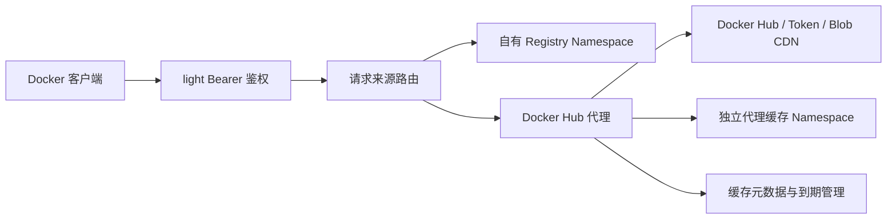

# Docker Hub 私有代理缓存方案

状态：核心代理缓存已实施，默认关闭；实际收敛与验证边界见下文。日期：2026-11-13。

## 1. 需求与确定的语义

用户已确认：“当前平台不存在”指 **light 缺少对应仓库或 tag**，不指补齐已有镜像中缺失的 CPU 架构。

推荐在现有自有仓库功能之外，增加 Docker Hub 按需代理缓存：

| 情况                              | 行为                                                     |
| --------------------------------- | -------------------------------------------------------- |
| 自有仓库存在所请求的 tag/manifest | 继续从自有仓库响应                                       |
| 自有仓库或 tag 不存在             | 通过 light 鉴权后向 Docker Hub 回源                      |
| 来源为代理缓存，即使已缓存索引    | 每个 manifest/index 拉取请求都重新访问 Hub，检查当前内容 |
| blob 完整缓存且未满 7 天          | 使用缓存，通过 light 返回给用户                          |
| blob 缺失或到期                   | 重新从 Hub 下载、校验并缓存                              |
| 匿名访问代理内容                  | 拒绝，不回源、不创建缓存                                 |
| Hub 不存在镜像、拒绝或不可用      | 返回明确错误，不将旧索引冒充最新内容                     |

“每次拉取索引”指 Registry manifest 接口：多架构是 OCI index / Docker manifest list，单架构是 image manifest；不是刷新仓库列表或 tags/list。

**7 天采用固定期限：从 blob 完整下载、摘要校验和提交成功时起计算 168 小时，读取不续期。** 到期后不再作为缓存命中；物理删除可等待在途读取完成。若未来需要“最后访问后 7 天”的滑动期限，应作为单独策略变更，不能暗中延长此处期限。

继续使用本地文件，不引入额外数据库。

## 2. 访问方式与名称映射

推荐客户端显式使用 light 的地址：

```bash
docker login registry.example.com --username robot-实际ID
docker pull registry.example.com/alpine:latest
docker pull registry.example.com/library/alpine:latest
docker pull registry.example.com/nginxinc/nginx-unprivileged:latest
```

| light 请求路径    | Docker Hub 上游仓库                              |
| ----------------- | ------------------------------------------------ |
| `alpine`          | `library/alpine`                                 |
| `library/alpine`  | `library/alpine`                                 |
| `namespace/image` | 保留原名称                                       |
| 自有多级路径缺失  | 按完整名称请求 Hub，Hub 不支持或不存在则返回错误 |

`alpine` 与 `library/alpine` 的代理数据可按规范化 Hub 名称共享缓存；自有仓库仍按用户请求的完整 light 路径精确匹配，不合并两个自有仓库。

上游固定为 Docker Hub 的 Registry API，不接受客户端提供任意 URL、registry host 或 token endpoint。名称中出现域名形式也不能让程序改为请求那个域名；不支持的外部 registry 名称直接拒绝。

首版以 `docker login light地址` 和 `docker pull light地址/镜像` 验收，不承诺 Docker daemon 的 registry-mirrors 配置会自动带上 light 私有认证。

## 3. 架构与数据隔离



复用现有 Distribution 协议、StorageDriver 和 blob/manifest 存储接口，保持每进程只有一个 handlers.App。代理缓存使用另一份 filesystem driver / storage Namespace，由 light 的只读代理处理器访问；不再启动另一个 Registry HTTP 服务。

建议数据职责：

- `/var/lib/light/registry/`：用户主动 push 的原生数据，保留现有行为。
- `/var/lib/light/hub-cache/registry/`：Hub manifest、index、配置和 layer，只能由内部回源流程写入。
- `/var/lib/light/hub-cache/metadata/`：按规范化上游仓库或 digest 分片的缓存来源、tag 映射、下载状态、cachedAt/expiresAt、代次与最后回源状态。
- `/var/lib/light/hub-cache/tmp/`：未校验完成的下载，不作为可用缓存。

缓存元数据继续使用有界原子文件，每份不超过现有 JSON 上限；限制条目总数和临时下载规模，不把全部缓存塞入 management.json。快照写入失败时不发布新的缓存命中状态；重启后核对完整对象、记录与临时文件，记录损坏时暂停对应缓存功能，不影响自有仓库。

**自有数据与缓存物理隔离。** 缓存内部可按 digest 去重，但不让缓存清理删除自有镜像的共享文件。暂不做跨两个根目录的物理去重或硬链接；缓存命中不等于把上游镜像永久导入自有仓库。

## 4. 本地优先与私有授权

### 4.1 路由边界

鉴权通过后，再判断自有仓库的精确引用：

1. tag 链接存在且清单完整：自有响应，不访问 Hub。
2. 明确的仓库/tag 不存在：进入代理流程。
3. tag 存在但清单或 layer 损坏、I/O 失败、维护中或权限不足：返回原错误，不能借 Hub 镜像掩盖损坏。
4. `/manifests/<digest>`：自有同摘要清单优先，否则进入已授权的 Hub digest 查询。
5. blob 请求：先检查自有仓库关联，再检查代理仓库已验证的描述符关系；不能将任意传入 digest 直接拼接成回源请求。

客户端 PUT/PATCH/POST 仍进入自有 Registry。用户将同名 tag 主动 push 到 light 后，该自有 tag 优先；其余缺失 tag 继续允许回源。代理数据不通过客户端写接口修改。

若从代理缓存复用 layer 到自有 push，首版可以按正常上传处理，不直接复制链接跨根目录引用；未来如增加导入优化，必须完整校验并进入自有上传保护，不能依赖会过期的缓存文件。

### 4.2 私有约束

代理缓存始终私有，使用有效 light 机器人令牌的 pull scope；管理员会话只用于控制台查看/清理，不把它转发给 Hub。机器人仍不增加权限范围配置。

需要特别处理“同名自有仓库公开、缺失 tag 走代理”的情况：

- 匿名用户只能访问该仓库的自有公开内容。
- 一旦路由到代理 tag/index/blob，额外执行私有来源校验，在任何出站请求前拒绝匿名身份。
- public API 的列表、数量、搜索和详情只包含自有公开数据，不展示代理缓存或其元数据。
- 仅有代理数据的仓库显示固定私有，不能通过现有公开开关使缓存匿名可读。混合仓库的公开开关只作用于自有内容。

即使两个来源的 layer digest 相同，也只能通过相应 Namespace 的仓库关联和鉴权读取，不能因另一处文件存在而放宽权限。机器人停用、撤销和到期仍逐请求检查。

删除一个自有 tag 或清除缓存后，下一次私有拉取可能再次触发 Hub 回源；缓存清理不是永久阻止这个上游镜像。

## 5. 每次 manifest/index 请求重新回源

代理请求执行以下步骤：

1. 验证本地凭据、仓库 scope、路径和限额。
2. 在固定 Hub 仓库范围取得上游 pull token；light 机器人秘密不发送给 Hub。
3. 对客户端所请求的 tag 或 digest 发起上游 manifest GET，使用受支持的 Accept 媒体类型；即使客户端是 HEAD，也通过上游 GET 获取当前清单后返回无正文的 HEAD 响应。
4. 限制清单大小和类型，计算原始响应正文的 digest；存在响应摘要时核对，按 digest 请求时必须与请求摘要一致。
5. 原样保存已验证的清单及描述符关系，再返回正文或 HEAD 元数据。

每次请求都实际检查上游，不设置“若干分钟内直接返回本地 tag/index”的正向 TTL，也不把历史校验结果当作本次检查成功。首版不跨 manifest 请求合并检查，避免模糊“每次回源”的语义；并发预算用于限制出站负载。客户端的条件头不能让服务器跳过上游检查。

多架构索引不重写、不替换子平台，不预先下载所有架构。客户端选中某个平台后，按该子清单 digest 拉取；子清单也按此流程回源。固定 digest 不存在“指向更新版本”的概念，但仍按照本需求重新请求上游验证可取性。

缓存映射只在成功校验后更新。tag 从摘要 A 变成 B 时，新的请求返回 B；已经拿到 A 的客户端可以继续按 A 的子清单和 blob digest 完成拉取。旧 blob 的期限仍独立计算，不因 tag 变动就立即删除。

Hub 返回 404、拒绝访问、429 或超时时，不返回旧 tag/index。区分不存在、上游限流和暂时不可用，保留合理的 Retry-After 信息；日志记录脱敏原因。blob 缓存命中并不保证 Hub 故障时还能完成一次按 tag 拉取，因为本次索引检查仍是必需步骤。

## 6. blob 缓存、完整性与 Range

### 6.1 状态与下载

按 digest 管理 `missing → downloading → ready → expired → evicting`，状态带单调代次标识；同时保存它来自哪些已验证 Hub 仓库描述符，防止串仓库读取。

- ready 且 `now < expiresAt`：从独立缓存 Namespace 读取，支持 GET/HEAD 和 Range，读取不改变 cachedAt。
- missing / expired：创建受控回源任务，完整流式写入临时文件，校验大小与 digest，通过 StorageDriver/blob API 提交后再标为 ready。
- 多个请求命中同一下载：共享一次填充，等待者受并发、等待时限和取消约束，不为每个客户端重复下载。
- 失败、取消、摘要不符、磁盘写满：不提交 ready，保留自有数据，清理临时文件或标记待清理。

首版采用“完整落盘校验后，再向客户端流式读取”的方式，避免把未经校验的回源数据提前返回。不会整层载入内存，但冷缓存首字节延迟较高；反向代理超时必须覆盖允许的缓存填充时长。这一取舍应通过大层测试确认，后续再考虑有界的边下载边转发。

冷缓存收到 Range 请求时仍先填充完整 blob，随后通过本地完整对象返回所需范围，不将局部响应当作完整缓存。HEAD 未命中可只向 Hub 查询描述符，不因 HEAD 下载整层，也不开始或延长 7 天期限。

### 6.2 七天到期

`expiresAt = verifiedCommitAt + 168h`。到期后新的请求不得继续直接使用旧缓存；重新完整获取并校验成功后，才开始下一轮期限。manifest/index 的本次回源成功不能续期所有关联 blob。

后台定期清理到期内容，启动时恢复清理状态；物理删除需等待该 digest 的在途读取和填充结束。删除前持锁重查记录代次与到期时间，避免旧清理任务删掉刚重新填充的内容。进程退出取消/等待下载及清理任务后再释放数据目录锁。

manifest/index 快照主要供来源关联和管理查看，不是 pull 的最新性依据。旧快照、tag 历史和仓库元数据按有限保留策略清理，避免即使 blob 到期，索引记录仍无限增长；再次请求时可以从 Hub 重建。

到期清理不要求现有缓存 manifest 已不再引用 blob：代理缓存缺失可回源，与自有镜像“引用仍在就必须保留”的 GC 语义不同。缓存维护不能复用自有 GC 的永久引用规则来阻止 7 天过期，也不能让缓存删除进入自有数据根目录。

## 7. 与现有维护、容量和界面的关系

### 7.1 两类存储策略

| 数据类型             | 保留与删除规则                                        |
| -------------------- | ----------------------------------------------------- |
| 用户 push 的自有数据 | 现有引用保护、24 小时上传保护和管理员预览确认         |
| Hub 代理 blob        | 私有读取，完整提交后固定缓存 7 天，到期可自动清理     |
| 回源中的临时文件     | 在途任务保护；失败/重启后按明确状态回收，不算完整缓存 |

不要对缓存套用原生 push 的 24 小时租约并反复续期，导致延长 7 天期限。自有维护与缓存清理在不同根目录进行，但应共享进程退出、磁盘预留和任务排空约束。

回源应有独立的并发槽、单 blob 上限、临时文件总量与缓存空间预算；建议初始并发 4，具体大小上限在实施时结合现有 20 GiB 请求限制和可用盘配置确定。下载前按已知大小预留容量，并处理并发下载/原生上传争用；大小未知时使用有界流及写入中检查，不能只做一次 Statfs 就无限写。

磁盘不足时先清理已到期的安全候选，仍不足返回明确错误，不默认提前淘汰未满 7 天的内容，也不悄悄改成无限制透传。禁止将匿名公开页面查询变成可触发 Hub 大批量下载的入口。

### 7.2 页面

- 仓库/镜像增加“自有”与“Docker Hub 代理”来源标识。
- 代理项显示上游名称、最后回源时间、缓存量与到期状态；公开开关不作用于代理内容。
- 代理多架构图尚未全部缓存时，完整逻辑大小或创建时间可以为空，显示“未完整缓存”/“—”；不为补齐页面数字而下载所有平台。
- 页面刷新只展示当前快照，不把管理列表刷新等同于一次 Docker 拉取，也不自动刷新 Hub 全部标签。
- 维护页增加清理过期缓存、手动清空代理缓存和缓存任务状态。手动清空与普通定时扫描区分，保留审计，不淹没现有最近 12 条用户维护任务。

## 8. 上游安全、凭据和限流

首版来源限定为 Docker Hub 的公开镜像，默认匿名回源。light 是私有访问入口，不意味着上游也是私有仓库。

可后续增加专用的只读 Hub 账户用于认证拉取，但必须明确：凭据能访问的上游内容可能被所有有效 light 机器人获取。若支持账户，应使用不具有私有仓库访问权的专用身份，或另行实现可验证的上游访问限制；不在首版静默接入个人全权限账户。

固定 Hub Registry 和认证端点，明确控制 token realm、scope 及 HTTPS 跳转。blob CDN 跳转可由受信上游发起，但必须限制次数、协议、目标主机规则及解析地址，阻止访问回环、链路本地、私网、云元数据等地址；跨主机跳转不转发 light Authorization、Cookie 或不适用的 Hub 凭据。实现时验证 Docker 实际 CDN 域名并维护兼容清单，不能简单跟随任意 Location。

manifest/body 大小、重定向、重试、token 交换和负面结果均受预算约束。上游错误不能触发无限循环；原生本地缺失与上游失败分开记录，不能因为超时就创建一个成功缓存。

每次重新获取清单会产生 Hub 请求；代理不绕过 Hub 的拉取限额、公平使用或滥用限制。具体额度以部署时官方政策为准，不在代码写死套餐数字。网络失败可重试，上游 429 需遵循等待策略，不能承诺缓存一定避免所有限流。

## 9. 实现路线与配置建议

新增 `internal/hubproxy`，封装受控上游客户端、manifest 获取、blob 填充与元数据。路由和来源鉴权放在现有 Registry 外层，缓存落盘使用独立的 StorageDriver/Namespace；生命周期归现有 Server/Registry 统一关闭。

固定版本的远端客户端位于上游 `internal/client`，light 不能直接导入。拟在 `internal/hubproxy` 基于公开的只读 HTTP/token 协议封装受控客户端，复用现有公开类型与本地存储接口，不直接引用依赖的 internal 包或修改模块缓存。

不直接开启整个 handlers.App 的 proxy 模式：那会改变自有 push 能力，也不能覆盖混合来源的私有规则。固定版本内置代理可作参考，但不能直接套用其缓存调度：其 tag 查询在上游失败时会回退本地，与本需求严格检查最新性不同；默认缓存/到期、并发回源行为也需按本方案实现。

当前通过页面“系统设置 → 应用配置”管理以下设置，保存后即时生效。配置存入管理快照，与缓存元数据分开；首次直接取代码默认值，不读取旧 `LIGHT_HUB_*` 环境变量。

| 页面配置            | 默认值  | 用途                             |
| ------------------- | ------- | -------------------------------- |
| Docker Hub 私有代理 | 关闭    | 启用缺失仓库/tag 回源            |
| 缓存容量            | 10 GiB  | 完整 blob 与预留填充空间的总预算 |
| 单个 blob 上限      | 20 GiB  | 同时受总预算和可用盘约束         |
| 回源并发数          | 4       | 清单与 blob 共用的回源并发       |
| 回源超时            | 1800 秒 | 整数秒总预算，另有空闲超时       |

对代理 manifest 请求按来源 IP 与机器人身份分层限流，独立于原生 Registry 传输；配置私有 IP Header 时沿用现有回退规则。并发或速率预算不足时返回明确的 429/重试提示，避免有效机器人也能无界消耗 Hub 配额。

上游固定 Docker Hub，blob TTL 固定 168h；首版不提供任意镜像源、网页修改 endpoint 或上游凭据的入口。页面仅修改上述运行策略，保存即时应用。以上默认容量是个人使用的起点，超过预算的镜像明确拒绝，不能一边声明固定 7 天保留，一边静默执行提前淘汰。

原型首先验证上游认证/redirect、manifest digest 检查与完整 blob 校验，并覆盖固定版本上游代理的相关边界，再接入真实请求。不得仅依靠一个“文件存在”的缓存命中判断。

## 10. 验收清单

1. light 不存在仓库/tag 时，机器人通过同一地址拉到 Hub 官方和命名空间镜像；源不存在返回正确错误。
2. 自有 tag 优先且不访问 Hub；自有内容损坏不被 Hub 同名镜像掩盖；主动 push 同名 tag 后转为自有响应。
3. 代理缓存无论是否命中都拒绝匿名，公开自有仓库里的代理 tag/blob 也不泄露；拒绝时不发出上游请求。
4. 每个代理 manifest/index GET/HEAD 都能观测到对应上游请求；tag 更新下一次请求即可见；上游失败不返回旧索引。
5. 多架构由客户端选择，保留原始索引、子清单和 digest；缓存不补造缺少的 CPU 架构。
6. blob 7 天内只下载一次，读取和索引检查不续期；到期重新下载；同 digest 并发填充不重复回源，重启不重置期限。
7. 部分下载、摘要错误、短读、Range、空 blob、磁盘满、取消和超时不发布无效缓存；冷 Range 最终返回正确字节。
8. 到期清理与重填、在途读取、进程退出并发时不误删；缓存根目录删除不会触及自有数据和备份。
9. 缓存元数据损坏/超量、Hub 429/401/403、token 过期、恶意 realm/redirect、DNS 与 CDN 变化按安全策略失败。
10. 原有公开/私有、机器人撤销、自有推送/删除、24 小时上传保护、维护、页面分页与复制功能全部回归。

## 11. 实施收敛与验证边界

本节描述实际代码，前文为设计语义：

- `internal/hubproxy` 通过受控 HTTP/token 客户端回源，缓存只用独立 Distribution Namespace 的 Blob API/Vacuum；自有 App 不启用全局 proxy 模式。
- 个人规模下采用独立 `metadata/state.json` 原子快照，最多 8 MiB，包含 1024 份清单和 16384 个 blob 记录，预留未来 blob 记录所需字节。原始清单用 base64 保存精确字节，不因 JSON 格式化变化。未采用按仓库分片，也不额外持久化第二份 tag 索引。
- 清单字节保存在快照；blob 临时数据使用 Distribution 自身的上传接口，启动以其公开 PurgeUploads/API 清理残留，不手动创建内核路径。
- 缓存视图集中在“存储维护”，显示私有代理来源、上游仓库/tag、最后回源、递归已缓存 blob 字节和到期状态；自有仓库列表标记“自有”，不将两种来源混入现有列表/详情 API。代理多架构尚未完整缓存时显示未完整缓存，不计算完整逻辑大小或下载其它架构。
- 定时/请求前过期清理排空在途缓存请求；手动清理异步执行并审计，不进入自有维护任务的最近 12 条列表。当前没有持久化的代理任务历史，重启后重新扫描，不重放手动清空动作。
- 同摘要填充串行合并；发起下载的请求取消时，未完成填充取消，其它等待者可重新尝试。关闭取消所有下载和等待请求。
- 清单每次实际回源，不合并；清单与填充共享并发预算。清单按机器人与 IP 各 60 次/分钟，总请求并发 64，未提供自动重试，429 返回 Retry-After。
- 单 blob 上限最大 20 GiB。blob 预算不包含最多 8 MiB 的元数据和少量 Distribution 链接/上传状态文件，磁盘预留另行检查；空间仍不足时明确失败，不提前淘汰未过期 blob。
- 上游读取采用固定主机直连，不支持 HTTP_PROXY/HTTPS_PROXY；网络读取空闲时限 5 分钟。CDN 主机限定官方当前/历史记录列出的精确域名，不使用 R2 通配。
- 后端临时 fixture 验证清单刷新/错误、摘要、冷/热 Range、HEAD、空 blob、并发、固定 TTL、重启、清理/退出、恶意跳转和私有路由；前端验证来源展示与清空确认。真实 Docker Hub、多平台客户端选择、真实 CDN/磁盘满/断电及容器部署尚待专项验收，不能将替身测试描述为线上验收。

应用配置已改为动态发布：Registry App 不重建，Hub 缓存启用后保留实例，关闭只拒绝新请求；并发使用共享计数，超时取请求开始时的设置。缩小容量不删除未过期缓存，不取消在途已预留下载；设置持久化失败时保留旧运行策略。

## 12. 参考资料

- [Distribution pull-through cache](https://distribution.github.io/distribution/recipes/mirror/)：上游提供相关机制，但默认行为不等同于本项目混合读写与严格刷新需求。
- [固定版本 tag 代理实现](https://github.com/distribution/distribution/blob/v3.1.2/registry/proxy/proxytagservice.go)：本地源码已核对其上游失败回退行为。
- [固定版本 blob 代理实现](https://github.com/distribution/distribution/blob/v3.1.2/registry/proxy/proxyblobstore.go)：作为下载与缓存接口参考，需另做预算、完整性和清理适配。
- [Registry HTTP API V2](https://distribution.github.io/distribution/spec/api/)：manifest、digest、blob、Range 与协议错误语义。
- [Docker Hub 拉取政策](https://docs.docker.com/docker-hub/usage/pulls/)：回源仍受上游政策限制。

- [Docker 官方网络允许列表](https://docs.docker.com/desktop/enterprise/allow-list/)与[历史 R2 域名更正](https://github.com/docker/docs/issues/21960)：固定 CDN 主机的核对依据。
